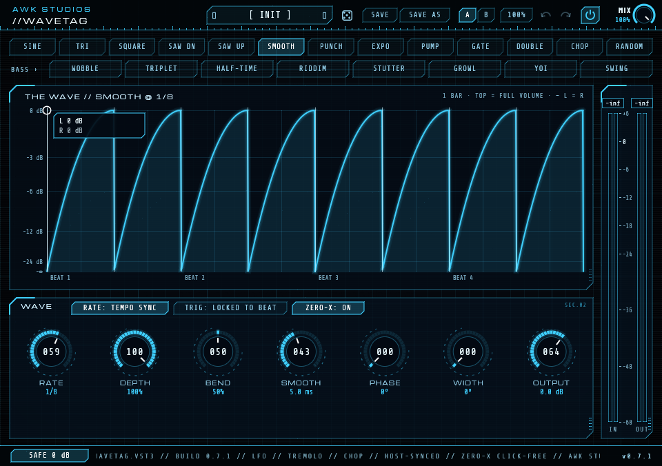

# WAVETAG

**Tempo-synced LFO volume shaper and tremolo, with 21 shapes including a dubstep/riddim BASS row.**



WAVETAG shapes volume in time with the beat. Pick a shape and a rate, and THE WAVE shows the real gain curve over one bar with a live playhead. It locks to FL's grid while playing, runs free in Hz mode, or retriggers on MIDI notes.

## Features

- **21 shapes:** SINE, TRI, SQUARE, SAW DN, SAW UP, SMOOTH, PUNCH, EXPO, PUMP, GATE, DOUBLE, CHOP and RANDOM, plus a BASS row: WOBBLE, TRIPLET, HALF-TIME, RIDDIM, STUTTER, GROWL, YOI and SWING.
- **RATE** from 4 bars to 1/64 (dotted and triplet), or free in Hz.
- **DEPTH, BEND, SMOOTH, PHASE, WIDTH** (stereo phase offset for auto-pan).
- **MIDI retrigger** and **ZERO-X** (volume changes only at zero crossings, so there are no clicks on bass).
- Zero latency. MIX, OUTPUT and SAFE.
- 83 factory presets.

## Install

Windows 64-bit, VST3. Built and tested in FL Studio.

1. Download `WaveTag-v0.7.1-win64.zip` from [Releases](../../releases/latest).
2. Copy `WaveTag.vst3` into `C:\Program Files\Common Files\VST3\`.
3. Copy the files in `presets` into `Documents\Awknode\Presets\WaveTag\` (create the folder if it doesn't exist).
4. Rescan plugins in your DAW.

## Using it

Every awk studios plugin has the same top strip: preset browser, A/B, undo/redo, power (bypass) and a global MIX. Knobs drag up and down (hold Ctrl or Shift for fine control), scroll to nudge, and double-click to reset. **SAFE** in the footer is an output limiter that keeps the plugin from going over 0 dBFS; it's on by default.

The full control reference is in the **[manual](docs/MANUAL.md)**.

## Build from source

You'll need Docker. Clone this repo next to the [nice-plug-awk](https://github.com/awknode/nice-plug-awk) framework fork, then run the build script:

```sh
git clone https://github.com/awknode/wavetag
git clone -b awk-studios https://github.com/awknode/nice-plug-awk
cd wavetag && ./build.sh
```

The plugin lands in `target/bundled/WaveTag.vst3`.

## License

GPL-3.0. See [LICENSE](LICENSE). Built with [nice-plug](https://codeberg.org/RustAudio/nice-plug).

---

More awk studios plugins: [VISE](https://github.com/awknode/vise) · [SALVE](https://github.com/awknode/salve) · [HOIST](https://github.com/awknode/hoist) · [KILN](https://github.com/awknode/kiln) · [PATINA](https://github.com/awknode/patina) · [CHOPSHOP](https://github.com/awknode/chopshop) · [THROWBACK](https://github.com/awknode/throwback) · [THROW FX](https://github.com/awknode/throw-fx) · [KICKNULL](https://github.com/awknode/kicknull) · [ALLEYVERB](https://github.com/awknode/alleyverb) · [dBCOMP](https://github.com/awknode/dbcomp) · [dBVOX](https://github.com/awknode/dbvox)

### Dice (random patch)
The dice button next to the preset box rolls a random patch. **Shift+click** nudges every control a little instead. **Undo** takes either back. Levels, mix, oversampling, the safety limiter and bypass are never touched, so a roll can't blast you or go silent.
